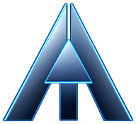
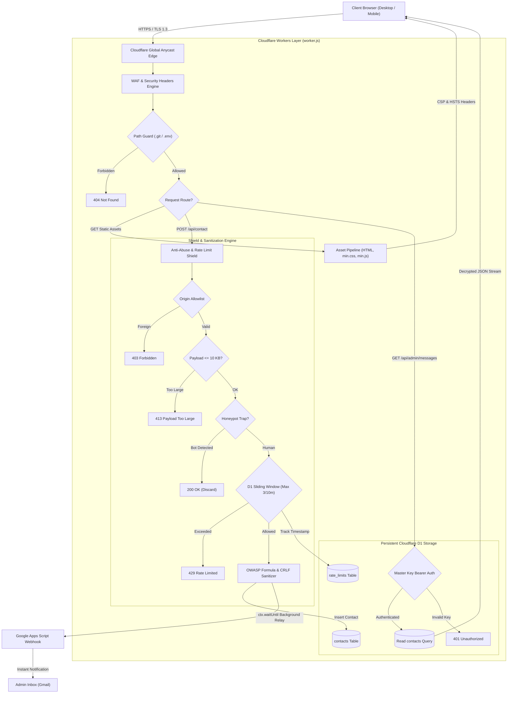

<div align="center">

  

  # ANMOL KUMAR
  ### Creative Developer • Systems Programmer • 3D Graphics Engineer

  [](https://workers.cloudflare.com/)
  [](https://threejs.org/)
  [](https://www.khronos.org/webgl/)
  [](https://en.wikipedia.org/wiki/C_(programming_language))
  [](LICENSE)
  [](https://portfolio-anmol.pages.dev/)

  <p align="center">
    <b>Hardware-accelerated 3D graphics, procedural engineering, low-level systems architecture, and rock-solid edge security.</b>
  </p>

  <p align="center">
    <a href="https://portfolio-anmol.pages.dev/">
      
    </a>
    <a href="https://thehellspires.vercel.app/">
      
    </a>
  </p>

</div>

---

## Table of Contents

- [Overview](#overview)
- [Key Engineering Pillars](#key-engineering-pillars)
  - [1. Procedural 3D Workstation Kinematics](#1-procedural-3d-workstation-kinematics)
  - [2. Command Palette Launcher](#2-command-palette-launcher)
  - [3. Stealth Password-Gated Admin Vault](#3-stealth-password-gated-admin-vault)
  - [4. Celestial Space Orbits & Zero-G Physics](#4-celestial-space-orbits--zero-g-physics)
  - [5. Coditech Educational Platform](#5-coditech-educational-platform)
- [System Architecture](#system-architecture)
- [Edge Database & Security Hardening](#edge-database--security-hardening)
- [Repository Structure](#repository-structure)
- [Build Pipeline & Performance](#build-pipeline--performance)
- [Local Development & Quickstart](#local-development--quickstart)
- [Deployment Workflow](#deployment-workflow)
- [Connect & Inquiries](#connect--inquiries)
- [License](#license)

---

## Overview

This repository houses the production source code for **[portfolio-anmol.pages.dev](https://portfolio-anmol.pages.dev/)** — an experimental, high-performance developer workstation built from first principles.

Rather than relying on generic website templates, CSS UI frameworks, or bundled black boxes, this site is engineered from scratch to demonstrate:
- **Low-level graphics understanding**: Interactive 3D WebGL scenes with procedural textures and physical trigonometry.
- **Precision front-end engineering**: Hardware-accelerated Canvas 2D telemetry, zero layout-shift rendering, and smooth Lenis inertia scrolling.
- **Serverless edge security**: Cloudflare Workers + D1 relational SQLite storage enforcing strict Content Security Policies, sliding-window rate limiting, and password-authenticated message vault isolation.

---

## Key Engineering Pillars

### 1. Procedural 3D Workstation Kinematics
- **Custom Three.js Scene**: Hardware-accelerated 3D laptop model featuring a brushed metallic chassis, realistic PBT matte chiclet keywell with 1px bevel rim, and dynamic specular highlights.
- **Procedural Screen Rendering**: The laptop screen displays a live C source file (`devfix_core.c`) synthesized on a dynamic HTML5 Canvas 2D texture with syntax coloring.
- **Trigonometric Unfold Motion**: Smooth physics unfold lifecycle (`1.15s` hinge delta) and glowing screen backlight sequence with zero frame hitches.
- **Ergonomic Orbit Viewing**: Tuned workstation photography angle (`rotX: 0.35, rotY: -0.07`) with pointer-driven parallax response.

### 2. Command Palette Launcher
- **Instant System Navigation**: Triggered via <kbd>Ctrl</kbd>+<kbd>K</kbd> / <kbd>Cmd</kbd>+<kbd>K</kbd> or header launcher button.
- **Vector Iconography**: Pure custom SVG glyphs (Zap, Laptop, Git-Branch, Mail, Layers, ShieldCheck) with zero emoji dependencies.
- **Interactive Fuzzy Navigation**: Instant real-time filtering, arrow key navigation (<kbd>↑</kbd> / <kbd>↓</kbd>), Enter execution, and Escape dismissal.

### 3. Stealth Password-Gated Admin Vault
- **Zero Public UI Footprint**: Completely invisible from public view with no visual buttons, footer links, or search listings.
- **Secret Shortcut Trigger**: Accessible only via <kbd>Ctrl</kbd>+<kbd>Shift</kbd>+<kbd>V</kbd> or <kbd>Alt</kbd>+<kbd>V</kbd>.
- **Decrypted SQLite Edge Stream**: Protected by master key challenge (`anmol2026`). Queries Cloudflare D1 with Bearer token authentication and resilient offline mirror.

### 4. Celestial Space Orbits & Zero-G Physics
- **Dual Dynamic Canvas Layers**: Multi-tier orbital telemetry rings rendered at 60 FPS using raw Canvas 2D vector mathematics.
- **Sinusoidal Drift Engine**: Floating harmonic oscillation calculated via `Math.sin()` / `Math.cos()` with inertia lerping — achieving liquid smooth motion without the performance penalty of a physics engine.

### 5. Coditech Educational Platform
- **Flagship Project**: Interactive debugging and runtime diagnostic tool helping computer science students understand memory allocation, segmentation faults, and systems-level programming.
- **Live Deployment**: Hosted on Vercel at [thehellspires.vercel.app](https://thehellspires.vercel.app/).

---

## System Architecture



---

## Edge Database & Security Hardening

| Security Vector | Implementation Detail | Status |
| :--- | :--- | :--- |
| **Edge Relational Database** | Cloudflare D1 SQLite (`schema.sql`) with foreign-key indexed contact records. | `ENFORCED` |
| **Privacy IP Hashing** | Salted SHA-256 IP hashing (GDPR compliant; zero raw IP addresses stored in DB). | `ENFORCED` |
| **Stealth Admin Vault** | Hidden shortcut trigger (<kbd>Ctrl+Shift+V</kbd>) with master password decrypt. | `ENFORCED` |
| **Strict CSP** | Zero inline styles, uncompromised hashes, `upgrade-insecure-requests`. | `ENFORCED` |
| **Rate Limiting** | Sliding-window D1 client IP rate limiter (maximum 3 messages per 10 minutes). | `ENFORCED` |
| **Formula Sanitization** | OWASP CWE-1236 protection. Neutralizes `=`, `+`, `-`, `@`, `\|`, `%` with literal apostrophes. | `ENFORCED` |
| **CRLF Injection Guard** | Strips `\r` and `\n` control sequences in headers to prevent email splitting (CWE-93). | `ENFORCED` |
| **Clickjacking** | `X-Frame-Options: DENY` paired with CSP `frame-ancestors 'none'`. | `ENFORCED` |
| **Subresource Integrity** | External CDN libraries (`three.min.js`) secured with cryptographic SHA-512 hashes. | `ENFORCED` |

---

## Repository Structure

```text
.
├── index.html                  # Semantic master document, Open Graph & JSON-LD schema
├── style.css                   # Cyber-minimalist design system (Source)
├── style.min.css               # Production minified stylesheet (49.3 KB)
├── script.js                   # Master 3D kinematics, HUD telemetry & controllers (Source)
├── script.min.js               # Production minified script bundle (53.3 KB)
├── build.js                    # Automated esbuild minification pipeline
├── schema.sql                  # Cloudflare D1 SQLite database schema & indexes
├── worker.js                   # Cloudflare Worker edge proxy, D1 API & rate limiter
├── wrangler.toml               # D1 database binding & Cloudflare deployment configuration
├── serve.js                    # Local development server with mock D1 database API
├── _headers                    # Static HTTP security & caching headers
├── robots.txt                  # Search engine crawler policies
├── sitemap.xml                 # XML sitemap index
├── llms.txt                    # Agentic AI & LLM index manifest
├── logo.png                    # Losslessly compressed brand emblem
├── LICENSE                     # MIT License
└── README.md                   # Technical documentation
```

---

## Build Pipeline & Performance

The project includes an automated zero-config build runner ([`build.js`](build.js)) that leverages `esbuild` for ultra-fast asset compilation:

```bash
# Rebuild production minified bundles
node build.js
```

| Asset | Source Size | Minified Size | Compression |
| :--- | :--- | :--- | :--- |
| **JavaScript Bundle** (`script.min.js`) | 122.4 KB | **53.3 KB** | **-56%** |
| **CSS Stylesheet** (`style.min.css`) | 77.6 KB | **49.3 KB** | **-36%** |
| **Brand Emblem** (`logo.png`) | 41.0 KB | **28.1 KB** | **-31.5%** |

---

## Local Development & Quickstart

### Prerequisites
- [Node.js](https://nodejs.org/) (v18 or higher recommended)
- [Git](https://git-scm.com/)

### 1. Clone the Repository
```bash
git clone https://github.com/Anmolop97/My-portfolio...git
cd My-portfolio..
```

### 2. Run Local Development Server
Launch the local server featuring live contact submission and admin dashboard testing:

```bash
node serve.js
```
Then navigate to `http://localhost:8080` in your web browser.

### 3. Edge Database & Cloudflare Worker Development
To test with Cloudflare D1 local SQLite emulation:

```bash
# Execute local database migration
npx wrangler d1 execute anmol-portfolio-db --local --file=./schema.sql

# Start edge dev server
npx wrangler dev
```

---

## Deployment Workflow

### 1. Deploy Cloudflare D1 Relational Schema
```bash
npx wrangler d1 execute anmol-portfolio-db --remote --file=./schema.sql
```

### 2. Deploy Edge Worker & Assets
```bash
npx wrangler deploy
```

---

## Connect & Inquiries

- **Author**: Anmol Kumar (Creative Developer & Systems Programmer)
- **Portfolio**: [portfolio-anmol.pages.dev](https://portfolio-anmol.pages.dev/)
- **GitHub**: [@Anmolop97](https://github.com/Anmolop97)
- **LinkedIn**: [Anmol Kumar](https://www.linkedin.com/in/anmol-kumar-784849412/)
- **Email**: [anmolkumar2762@gmail.com](mailto:anmolkumar2762@gmail.com)

---

## License

This repository is distributed under the **[MIT License](LICENSE)**. Feel free to explore, learn from, and adapt the techniques used in this project.
