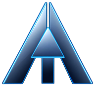

  

  # ANMOL KUMAR
  ### Creative Developer & Systems Engineer

  

  
  

  

    <a href="https://portfolio.anmolkumar.workers.dev/"><strong>🌐 Explore Live Workstation »</strong></a>
  

---

## 🚀 Highlights
- **Interactive 3D Workstation** — Hardware-accelerated Three.js laptop with procedural chassis, live C code terminal, and zero-G physics.
- **Space Radar Telemetry** — Canvas 2D orbital telemetry rings tracking systems architecture metrics in real time.
- **Coditech** — Educational developer platform built to teach root-cause debugging and memory safety intuition.
- **Global Edge Delivery** — Deployed globally on Cloudflare Workers with strict CSP and sub-50ms latency.

### 🛠️ Core Stack
**Systems & Web:** C · JavaScript (ES6+) · HTML5 · CSS3  
**Graphics & Motion:** Three.js (WebGL 2.0) · HTML5 Canvas 2D · Lenis Smooth Scroll  
**Cloud & Tools:** Cloudflare Workers · Linux · Git

---

© 2026 Anmol Kumar · MIT License
